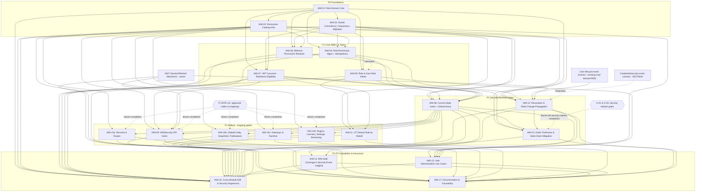

# IAM v1 — Final Stabilized Backlog & Implementation Issues

**Status:** Stabilized (final, read-only refinement consolidated)  
**Baseline:** `develop@ea55c6f728dcb0bc6fc47b69db49a809ee7fb4c6` (repo/GitHub live state not re-verified in this step)  
**Scope:** BitWrite IAM v1 (additive RBAC, deny-by-default). No Tenant/Multi-tenancy, no Scope/ScopeId/scoped/resource-context authorization, no permission inheritance, no explicit deny, no external role mapping, no MFA/TOTP enforcement, no mandatory external IdP, no Role hard-delete.

## 1. Immutable Architecture Decisions (preserved)
- **Identity/ownership:** BitWrite owns internal Users, Roles, Permissions, credentials, sessions, token lifecycle, and authorization. External IdPs are optional licensed plugins (authenticate only). JIT resolves/creates internal User with restricted default Role resolved by configured **RoleId** (must exist & Active; fail safely). No external role mapping.
- **Authorization model:** `User → Roles → Permissions` (additive). Multi-role; Effective Permissions = union of valid permissions from **Active** Roles assigned to **Active** User, evaluated for authorization (not JWT issuance). Permission is authorization unit; Role is assignment mechanism. Deny-by-default. Disabled User => none; Inactive Role => none; Retired/Unknown => never grant; deduped; consistent normalization.
- **RoleId:** canonical, permanent, immutable internal identity; used consistently in Domain/Application/Persistence/User-Role assignments/JIT/migration; no internal lookup/assignment by RoleName.
- **RoleName:** unique technical name (consistent case-insensitive normalization), JWT-facing role identifier, not internal identity; atomic uniqueness at persistence boundary. **Rename allowed only when `Role.Permissions.Count == 0`** (zero **stored** permission references, incl. retained Retired/Unknown), rejected if >=1; allowed again after all removed; `RoleId` and assignments unchanged.
- **Role lifecycle:** Active/Inactive; assign Active allowed, assign Inactive rejected; deactivating assigned role allowed and retains assignments; inactive contributes none; reactivation restores eligibility subject to current catalog/permissions; **no hard-delete**.
- **Permission Catalog:** product source code is sole SoT (codes, metadata, status, assignability). Redis stores Role data and assigned permission code references only. No runtime admin create/delete/modify of definitions; assign/remove existing assignable catalog permissions only. **Active:** assignable + may grant. **Retired/Unknown:** not newly assignable + never grant. Historical Retired refs retained.
- **Assignment idempotency:** reassigning existing Permission = successful no-op at Application boundary (no duplicate domain event, no unnecessary persistence write) while Domain `Role.AddPermission` duplicate invariant (`PERMISSION_ALREADY_ASSIGNED`) remains unchanged. Concurrency-safe.
- **JWT (RoleName-only claims):** may include RoleName only if (1) User Active, (2) Role currently assigned, (3) Role Active, (4) Role has >=1 Permission with code in official Catalog and status **Active**. No Permission claims, no RoleId authorization claim. **JWT issuance must not calculate/materialize/serialize or depend on Effective Permissions.** Standard claims preserved (`sub`,`sid`,`iss`,`aud`,`iat`,`exp`); preserve existing session/refresh architecture unless defect evidenced. Claim serialization and `RoleClaimType` explicitly defined/tested.
- **Current-state authorization:** JWT RoleName claims are hints only; **never authorize solely on JWT claim**. Validate current User state, current RoleId assignment, current Role state, current Catalog permission validity/status; deny-by-default and fail-closed.
- **MFA:** T-16/#638 architecture-readiness only (no implementation/enforcement in v1).
- **Ownership:** #640 = Permission Catalog decision record (not implementation mega-issue). #647 = session/refresh storage & core mechanics owner.

## 2. Gates & Unresolved Decisions (blockers/completion constraints)

| ID | Type | Status | Impact |
|---|---|---|---|
| **P-GATE-1** | Product decision | **Unresolved** | Official Permission Catalog codes/definitions (source-code SoT content). Infra/contracts can proceed; production-approved definitions and final semantics blocked until approved. **No permission codes invented.** |
| **P-GATE-2** | Product decision | **Unresolved** | Endpoint/use-case → Permission mappings. Engine/scaffolding/inventory can proceed; completion of IAM-09/10a–d “protected per approved mapping” and full rollout blocked until approved. |
| **U-01** | Architectural approval + Security release gate | **Unresolved** | Historical RoleName reuse mitigation (tombstone/alternative). **Mandatory now:** current-state validation + fail-closed; stale/renamed/reused scenarios in security tests. **Full IAM v1 security release blocked** until mitigation chosen/approved, implemented, and tested. |
| **U-02b** | Product decision | **Unresolved** | Explicit admin removal of stored **Retired** permission references. Retention/non-grant/non-assignability and rename invariant unchanged; no removal behavior finalized either way. |
| **U-03** | Security release gate | **Unresolved** | Freshness mechanism for already-issued Access Tokens: mechanism, enforcement point, **max stale-state window (per case)**, cache/version consistency, failure behavior must be approved/implemented/tested. IAM-13 may proceed (fail-closed/freshness work) but **cannot be Complete** until U-03 resolved; **full IAM v1 security release requires U-01 and U-03**. Short JWT expiry alone never sufficient. |
| **U-03a** | Implementation detail (within approved architecture) | **Unresolved** | Cache/version key design and invalidation propagation guarantees (no stale grant). |

## 3. Implementation Priority & Roadmap (topological)

**Priority model:** **P0** = correctness/data-integrity foundations with no P1 prerequisites. **P1** = required for secure functional v1 (and includes release/security gates). **P2** = operational completeness/assurance. **P3** = alignment/docs. IAM-08 is P1 implementation but **P0-equivalent security/release gate**; IAM-12/13 are release-gated for secure propagation/freshness.

| Phase | Focus | Issues (parallel where deps allow) | Exit criteria |
|---|---|---|---|
| **0. Foundations (P0)** | Domain/identity/catalog contracts | IAM-01 → {IAM-02, IAM-03} | Role-only domain invariants (rename = 0 stored refs incl. Retired/Unknown); RoleId-only assignments, atomic normalized RoleName uniqueness, migration/legacy handling; catalog infra/contracts (content gated by P-GATE-1). |
| **1. Core RBAC & Issuance (P1)** | State, evaluation, compliant tokens | {IAM-04, IAM-06, IAM-07} after 0; {IAM-05} after IAM-01,02 (+IAM-04 interaction) | Catalog-validated/idempotent role-permission ops; lifecycle-aware role/user-role admin; resolver correct from IAM-01/02/03; JWT 4-condition eligibility, RoleName-only claims, no Effective Permission calc, no IAM-05/06 dep. |
| **2. Security Gates (P1)** | Enforcement & propagation | IAM-08; IAM-12 (with #647, User lifecycle & credential event contracts); IAM-13 | Default-deny current-state authz (no trust in stale claims); matrix-driven propagation; fail-closed freshness/invalidation. IAM-13 completion & full security release gated by **U-01/U-03**. |
| **3. Rollout & JIT (P1)** | Protected surfaces & JIT | {IAM-09, IAM-10a–d} mapping-gated; IAM-11 | JIT compliant (configured RoleId, exists+Active, safe failure); module protections enforced per approved mappings (completion gated by **P-GATE-2**). |
| **4. Hardening & Assurance (P1/P2)** | Admin, audit, regression | IAM-15 (P1, mandatory Disable), IAM-14 (P2), IAM-16 (P2) + retained issues (#628,#639,#627/#644,#629/#645) | Mandatory user-admin security capability integrated/tested; audit coverage verified; E2E/security regression (incl. U-03 cases, U-01 scenarios) passes for implemented scope. |
| **5. Alignment (P3)** | Docs/traceability | IAM-17 | Docs/traceability reflect implemented outcomes and explicit gates (U-01,U-02b,U-03,P-GATE-1/2). |

**Critical path (technical):** `IAM-01 → IAM-02 → IAM-04 → IAM-12 → IAM-13 → IAM-16` (security gate path also `… → IAM-06 → IAM-08 → IAM-13`). **Parallelizable:** {IAM-02,IAM-03} after IAM-01; {IAM-04,IAM-06,IAM-07} after 0 (per deps); {IAM-05} after IAM-01,02; {IAM-10a–d} in parallel after IAM-03+IAM-08; {IAM-11} after IAM-02,05,07; {IAM-14,IAM-15} where deps satisfied. **No cycles.**

## 4. Dependency Graph (corrected, acyclic)

## 5. Issues (final stabilized)

> **Global:** each issue owns its relevant tests (IAM-16 E2E/regression only, no duplication). Deps are technically necessary. “Blocked by product decision/gate” means completion/claim blocked as stated (infra/hooks may proceed).

### IAM-01 — Role Domain Core (RoleId, RoleName, Lifecycle, Rename, Events)
- **Priority:** P0 | **Type:** Domain | **Size:** M | **Security impact:** High | **Readiness:** Ready to create/update (#642)
- **Problem:** Role aggregate lacks mandated lifecycle/rename invariants and clear domain boundary.
- **Objective:** Implement approved Role domain semantics only.
- **In scope:** Immutable canonical `RoleId`; unique normalized technical `RoleName` (contract); Active/Inactive lifecycle & transitions (no hard-delete); Rename allowed only when `Role.Permissions.Count == 0` (**zero stored permission references**, incl. retained Retired/Unknown), rejected if >=1, allowed again after all removed, `RoleId`/assignments unchanged; Role domain events; preserve `PERMISSION_ALREADY_ASSIGNED` and existing invariants; deactivation retains user-role assignments.
- **Out of scope:** User lifecycle/events (e.g. `UserDisabled`, owned by existing User domain/#626), persistence atomic uniqueness mechanism, migration, catalog infra, JWT, APIs, admin CRUD.
- **Dependencies:** None.
- **Implementation notes:** `RoleName` technical/JWT-facing, not internal identity. Stored-ref count governs rename (not Active/effective count).
- **Acceptance criteria:** (1) `RoleId` immutable. (2) `RoleName` normalized/validated consistently. (3) Rename succeeds iff zero stored refs (incl. Retired/Unknown counted). (4) Rename allowed at zero refs regardless of Active/Inactive or user assignment; `RoleId`/assignments unchanged. (5) Allowed again after all stored refs removed. (6) Active/Inactive transitions valid; deactivation retains assignments. (7) Duplicate permission add still throws `PERMISSION_ALREADY_ASSIGNED`.
- **Required tests:** Domain unit tests for lifecycle, rename matrix (0 refs, >=1 incl. Retired/Unknown, assigned/unassigned, active/inactive), normalization, invariants/events.
- **Definition of Done:** Domain code + tests pass; no user-lifecycle ownership leakage.
- **Relevant files/modules:** `src/BitWrite.OcelotConsole.Domain/Aggregates/Role/Role.cs`, `Domain/ValueObjects/Identity/RoleId.cs`, `Domain/Events/DomainEvents.cs`, `Domain/Exceptions/*`, `tests/BitWrite.OcelotConsole.Domain.Tests/*`.
- **Traceability:** F-Approved (RoleId/RoleName/lifecycle/rename/no hard-delete); #642.

### IAM-02 — RoleId Consistency, Atomic RoleName Uniqueness & Migration
- **Priority:** P0 | **Type:** Infrastructure/Application/Domain | **Size:** L | **Security impact:** High | **Readiness:** Ready after IAM-01
- **Problem:** Assignments/retrieval/persistence mix RoleName and RoleId (defective resolution/migration risk).
- **Objective:** Enforce `RoleId` as sole internal reference; provide normalized unique RoleName lookup; atomic uniqueness; safe migration.
- **In scope:** User role-reference contracts/handlers; repo interfaces/impl & Redis key/index; normalized unique RoleName index + atomic create/rename uniqueness; `GetByNameAsync` by name index (not `RoleId.From(name)`); deterministic/idempotent migration/compat for legacy name-based refs; explicit safe handling of orphan/unmappable refs.
- **Out of scope:** Catalog, Effective Permission calc, JWT issuance logic, authz rollout.
- **Dependencies:** IAM-01.
- **Implementation notes:** Support `RoleName -> current Role (RoleId,state,permission refs)` for IAM-07/08 without making RoleName internal identity.
- **Acceptance criteria:** (1) New assignments persist/read `RoleId` only. (2) Assign/remove/get/internal resolution RoleId-consistent. (3) Normalized RoleName uniqueness enforced atomically at persistence boundary. (4) RoleName lookup via dedicated unique normalized index. (5) Legacy data migrated/safely interpreted with no silent corruption/privilege escalation; unmappable refs explicit. (6) Concurrent conflicts cannot create duplicate normalized RoleNames.
- **Required tests:** App handler tests; persistence/integration for repos/index/uniqueness/migration; concurrency tests.
- **Definition of Done:** No Name-as-internal-identity paths; migration documented; tests pass.
- **Relevant files/modules:** `Domain/Aggregates/User/User.cs`, `Application/Interfaces/IUserRepository.cs`, `IRoleRepository.cs`, `Application/UseCases/Role/*`, `Infrastructure/Redis/RedisUserRepository.cs`, `RedisRoleRepository.cs`, `RedisKeyHelper.cs`, atomic/lock utilities.
- **Traceability:** F-Approved (RoleId canonical, atomic uniqueness, assignments); #631,#635,#636,#637,#642.

### IAM-03 — Permission Catalog Infrastructure (Source-Code SoT & Validation Contracts)
- **Priority:** P0 | **Type:** Application/Domain | **Size:** M | **Security impact:** High | **Readiness:** Ready after IAM-01 (content gated P-GATE-1)
- **Problem:** No official catalog; permissions unvalidated.
- **Objective:** Implement catalog infrastructure/contracts as sole SoT for definitions/metadata/status/assignability.
- **In scope:** Catalog models/registry/contracts, statuses Active/Retired (+ Unknown handling), normalization, lookup/validation/assignability APIs, read-only runtime (no mutation).
- **Out of scope:** Inventing official codes, runtime admin CRUD of definitions, Redis catalog storage, endpoint→permission mappings, implicit replacement/mapping.
- **Dependencies:** IAM-01.
- **Implementation notes:** Redis stores only assigned permission code refs. Production-approved definitions gated by **P-GATE-1** (no codes invented).
- **Acceptance criteria:** (1) Definitions sourced from code only; no runtime mutation. (2) Deterministic lookup for known Active/Retired and Unknown. (3) Only Active assignable; Retired/Unknown non-assignable and never grant. (4) Normalization consistent/reusable. (5) Historical Retired refs representable as non-granting.
- **Required tests:** Unit tests for lookup, normalization, status/assignability, unknown/retired.
- **Definition of Done:** Contracts/impl + tests; separated from P-GATE-1 content completion.
- **Relevant files/modules:** New catalog module (Application/Domain), `documents/BitWrite-Permission-Catalog-and-Authorization-Model-v1.1.md` (reference).
- **Traceability:** F-Approved (catalog SoT/rules); #640 (record).

### IAM-04 — Role-Permission Management & Idempotent Assignment (Catalog-Validated)
- **Priority:** P1 | **Type:** Application/Domain | **Size:** M | **Security impact:** High | **Readiness:** Ready after IAM-01,02,03
- **Problem:** No catalog-validated role-permission ops or app-boundary idempotency.
- **Objective:** Assign/remove role permissions with validation, concurrency safety, and idempotent reassignment.
- **In scope:** Assign/remove handlers (RoleId-targeted); Active-catalog-only assignment; reject Retired/Unknown/unassignable; idempotent no-op on reassignment (normalized membership check before domain call) with no duplicate domain event and no unnecessary write; preserve domain `PERMISSION_ALREADY_ASSIGNED`; safe handling consistent with stored-ref semantics.
- **Out of scope:** Effective Permission calc, endpoint policies, runtime catalog edits, hard-delete.
- **Dependencies:** IAM-01, IAM-02, IAM-03. **Interaction:** rename invariant depends on stored-ref count (U-02b unresolved — do not finalize removal behavior).
- **Implementation notes:** Concurrency-safe (check-then-act/atomic strategy). Stored Retired/Unknown refs count for IAM-01 rename rule.
- **Acceptance criteria:** (1) Only Active catalog permissions newly assignable. (2) Retired/Unknown/non-existent rejected. (3) Reassignment no-op success with no duplicate event/write. (4) Direct domain duplicate still throws `PERMISSION_ALREADY_ASSIGNED`. (5) Concurrent ops do not corrupt state. (6) Stored-ref semantics consistent with IAM-01 rename rule.
- **Required tests:** App tests (valid/retired/unknown/idempotent/remove), domain invariant, concurrency/race, retained-Retired-ref impact on rename consistency.
- **Definition of Done:** Handlers + tests; catalog/idempotency enforced.
- **Relevant files/modules:** `Application/UseCases/Role/*`, `Domain/Aggregates/Role/Role.cs`, repos/catalog contracts.
- **Traceability:** F-Approved (idempotency, catalog rules, retained refs); #643 split, #640 impl track.

### IAM-05 — Role & User-Role Administration Use Cases (Lifecycle-Aware)
- **Priority:** P1 | **Type:** Application | **Size:** M | **Security impact:** Medium/High | **Readiness:** Ready after IAM-01,02 (+IAM-04 interaction)
- **Problem:** Role mgmt and user-role assignment flows misaligned/incomplete.
- **Objective:** Lifecycle-aware role admin and user-role assign/remove using `RoleId`.
- **In scope:** Create/read/update-allowed-fields/activate/deactivate roles; assign Active role (reject Inactive); remove assignment; reactivate; deactivation retains assignments; align existing handlers and internal callers to IAM-01/02 contracts. No hard-delete.
- **Out of scope:** Effective Permission calc, JWT issuance, permission policy enforcement, external role mapping, MFA.
- **Dependencies:** IAM-01, IAM-02; IAM-04 (interaction for permission-state/rename preconditions surfaced).
- **Implementation notes:** Not a prerequisite for IAM-08 (authz core).
- **Acceptance criteria:** (1) Lifecycle operations valid; no hard-delete. (2) Inactive assignment rejected; Active assigned by `RoleId`. (3) Deactivation preserves assignments. (4) Remove/reactivate correct and auditable. (5) No RoleName as internal assignment identity.
- **Required tests:** App tests per operation/transition/negatives; integration for assignment retention on deactivation.
- **Definition of Done:** Use cases aligned/tested; legacy identity defects removed in covered flows.
- **Relevant files/modules:** `Application/UseCases/Role/*`, `Domain/Aggregates/User/User.cs`, `Domain/Aggregates/Role/Role.cs`, repos.
- **Traceability:** F-Approved (lifecycle, RoleId assignments); #631,#642,#643 split.

### IAM-06 — Effective Permission Resolver (Authorization-Only, Current-State)
- **Priority:** P1 (P0-equivalent release gate input) | **Type:** Application/Domain | **Size:** M | **Security impact:** High | **Readiness:** Ready after IAM-01,02,03
- **Problem:** No current-state effective-permission computation.
- **Objective:** Deterministic resolver returning union of valid effective permissions for authorization.
- **In scope:** Active user required; current assignments by `RoleId`; load current roles; exclude Inactive roles; resolve permission refs against catalog; exclude Retired/Unknown; dedupe; consistent normalization; side-effect free. For authorization/introspection only.
- **Out of scope:** JWT issuance/claims, policy registration, runtime catalog mutation.
- **Dependencies:** IAM-01, IAM-02, IAM-03 (IAM-04/IAM-05 not required).
- **Implementation notes:** Computes from current domain/persistence/catalog contracts.
- **Acceptance criteria:** (1) Active user + active roles => union of valid Active catalog permissions (deduped). (2) Inactive roles contribute none; disabled user none. (3) Retired/Unknown never contribute. (4) Reflects current state.
- **Required tests:** Unit matrix (multi-role, duplicates, inactive role, disabled user, retired/unknown-only/mixed) + integration with repos/catalog.
- **Definition of Done:** Resolver available/tested and consumable by IAM-08; no JWT dependency.
- **Relevant files/modules:** New application service/contracts, repos, catalog (IAM-03).
- **Traceability:** F-Approved (effective permissions for authz, not JWT).

### IAM-07 — JWT Issuance: RoleName-Only Claims & Eligibility
- **Priority:** P1 (release-gate for compliant token model) | **Type:** Application/Infrastructure/API | **Size:** M | **Security impact:** High | **Readiness:** Ready after IAM-01,02,03
- **Problem:** Token issuance misaligned with claim/eligibility contract.
- **Objective:** Issue compact JWTs with RoleName claims only per eligibility, no Effective Permission calculation.
- **In scope:** Include RoleName only if (1) User Active, (2) Role currently assigned, (3) Role Active, (4) Role has >=1 permission with catalog status **Active**. No Permission/RoleId authz claims. Define/enforce claim type, multi-role representation, and `RoleClaimType`. Preserve standard claims and session/refresh architecture unless defect evidenced.
- **Out of scope:** Effective Permission Resolver use/calc, current-state authz enforcement, MFA.
- **Dependencies:** IAM-01, IAM-02, IAM-03. **Not dependent on IAM-05 or IAM-06.**
- **Implementation notes:** Eligibility is per-role catalog-status check over stored refs, not union/effective-permission result.
- **Acceptance criteria:** (1) RoleName claims only for eligible roles. (2) No Permission/RoleId authz claims. (3) All 4 conditions enforced. (4) Role with only Retired/Unknown refs emits no claim. (5) Claim serialization and `RoleClaimType` explicit/consistent (gen+validation). (6) No Effective Permission calc/dependency on IAM-06. (7) Compactness independent of permission count.
- **Required tests:** Eligibility matrix unit tests; token content/absence tests; issuance/validation + `RoleClaimType` integration; session/refresh regression as touched.
- **Definition of Done:** Compliant issuance tested; IAM-06 independence verifiable.
- **Relevant files/modules:** `Infrastructure/Services/SecurityService.cs`, `Api/Program.cs`, auth/identity issuance callers, session/token tests.
- **Traceability:** F-Approved (JWT rule, no Effective Permission in issuance); #649.

### IAM-08 — Current-State Authorization, Permission Policies & Default-Deny
- **Priority:** P1 implementation (**P0-equivalent security/release gate**) | **Type:** Application/API/Security | **Size:** L | **Security impact:** Critical | **Readiness:** Ready after IAM-02,03,06,07
- **Problem:** Role-policy authz, undefined `Operator`, no current-state permission evaluation/default-deny.
- **Objective:** Permission-based authorization validating current state; deny-by-default; fail-closed.
- **In scope:** Requirements/handlers/policies mapped to catalog permissions; resolve JWT RoleName → current Role (normalized unique name) and validate User Active, current RoleId assignment, Role Active, current catalog validity/status via IAM-06/contracts; enforce requested permission; fix/remove dangling `Operator` and migrate legacy role policies as required.
- **Out of scope:** Defining official codes/mappings (P-GATE-1/2), full endpoint rollout (IAM-09/10a–d), #647 mechanics reimplementation.
- **Dependencies:** IAM-02, IAM-03, IAM-06, IAM-07.
- **Implementation notes:** Never authorize solely on JWT claim. Stale/unresolvable/unassigned/inactive/renamed-mismatch/ambiguous => deny. Fail closed on incomplete validation. Cache (if any) must not grant stale access (hooks with IAM-12/13).
- **Acceptance criteria:** (1) Missing/insufficient permission denied by default. (2) Current user/assignment/role/catalog state validated per decision. (3) Retired/Unknown never grant access. (4) Stale/invalid claims denied. (5) No undefined policy refs (incl. `Operator`). (6) Permission policies registered/testable.
- **Required tests:** Unit tests (handlers/requirements/resolution); integration (stale claim, deactivation/unassignment, disabled user, retired/unknown, deny-by-default).
- **Definition of Done:** Authz core ready/tested; safe for incremental rollout; release gate satisfied.
- **Relevant files/modules:** `Api/Program.cs`, new authz components, `IdentityController.cs`, `SecurityService.cs` interaction.
- **Traceability:** F-Approved (current-state, deny-by-default); #632,#649.

### IAM-09 — IAM & Security-Sensitive API Authorization Coverage
- **Priority:** P1 (completion mapping-gated P-GATE-2) | **Type:** API/Security | **Size:** M | **Security impact:** High | **Readiness:** Ready after IAM-04,07,08,#647 alignment
- **Problem:** IAM endpoints have missing/broken authorization.
- **Objective:** Protect IAM/security-sensitive endpoints/use cases with explicit justified exceptions.
- **In scope:** `IdentityController`, `AuditController`, `BootstrapController`, and IAM admin endpoints introduced/aligned by IAM-04/05/15; enforce at API and application path where alternates exist; minimal documented anonymous exceptions.
- **Out of scope:** Non-IAM product controllers (IAM-10a–d), inventing codes/mappings.
- **Dependencies:** IAM-04, IAM-07, IAM-08, #647 (alignment). **Gate:** P-GATE-1/2 for completion.
- **Implementation notes:** Inventory endpoints and classify authn/authz; policy hooks/scaffolding may proceed, completion blocked until approved mapping.
- **Acceptance criteria:** (1) Explicit authn/authz classification and approved mapped permission for protected endpoints. (2) Unauthorized/forbidden for missing/insufficient permission. (3) Anonymous endpoints minimal/justified. (4) No dangling IAM policy refs.
- **Required tests:** API integration per endpoint (authorized/unauthorized/forbidden/anonymous-allowed as justified).
- **Definition of Done:** IAM surface covered per approved mapping; tests pass.
- **Relevant files/modules:** `Api/Controllers/IdentityController.cs`, `AuditController.cs`, `BootstrapController.cs`, IAM handlers.
- **Traceability:** F-Approved; #632,#639,#643,#646,#647.

### IAM-10a — Product API Authorization: Services & Routes
- **Priority:** P1 (completion mapping-gated) | **Type:** API/Security | **Size:** M | **Security impact:** High | **Readiness:** Ready after IAM-03,08
- **Scope:** Endpoint inventory/protection for `ServicesController`, `RoutesController` and handlers; deny-by-default; no bypass via alternate paths. **Dependencies:** IAM-03, IAM-08. **Gate:** P-GATE-1/2.
- **AC/Tests/DoD:** Approved mapping enforced, allow/deny integration tests per area, coverage evidenced. **Traceability:** #632.

### IAM-10b — Product API Authorization: Global Configuration, Snapshots & Publications
- **Priority:** P1 (completion mapping-gated) | **Type:** API/Security | **Size:** M | **Security impact:** High | **Readiness:** Ready after IAM-03,08
- **Scope:** `GlobalConfigurationController`, `SnapshotsController`, `PublicationsController` and handlers. **Dependencies:** IAM-03, IAM-08. **Gate:** P-GATE-1/2.
- **AC/Tests/DoD:** Approved mapping enforced, integration allow/deny tests, evidenced. **Traceability:** #632.

### IAM-10c — Product API Authorization: Gateways & Runtime
- **Priority:** P1 (completion mapping-gated) | **Type:** API/Security | **Size:** M | **Security impact:** High | **Readiness:** Ready after IAM-03,08
- **Scope:** `GatewaysController`, `RuntimeController` and handlers. **Dependencies:** IAM-03, IAM-08. **Gate:** P-GATE-1/2.
- **AC/Tests/DoD:** Approved mapping enforced, integration allow/deny tests, evidenced. **Traceability:** #632.

### IAM-10d — Product API Authorization: Plugins, Licenses, Settings & Remaining Management
- **Priority:** P1 (completion mapping-gated) | **Type:** API/Security | **Size:** M | **Security impact:** High | **Readiness:** Ready after IAM-03,08
- **Scope:** `PluginsController`, `LicensesController`, `SettingsController` and any remaining management endpoints identified; justify any anonymous behavior explicitly. **Dependencies:** IAM-03, IAM-08. **Gate:** P-GATE-1/2.
- **AC/Tests/DoD:** No in-scope endpoint without explicit classification; approved mapping enforced, integration allow/deny tests, evidenced. **Traceability:** #632.

### IAM-11 — JIT Provisioning: Restricted Default Role by Configured RoleId
- **Priority:** P1 | **Type:** Application/Domain/Infrastructure | **Size:** M | **Security impact:** High | **Readiness:** Ready after IAM-02,05,07
- **Problem:** JIT hardcodes role name and does not validate configured default role.
- **Objective:** Compliant JIT with configured default `RoleId`.
- **In scope:** Resolve default RoleId from config; require existing & Active role; safe failure if missing/invalid/inactive; assign by `RoleId`; issuance via IAM-07-eligible claims; preserve issuer+subject rules; no external role mapping.
- **Out of scope:** External IdP implementation/mapping, MFA.
- **Dependencies:** IAM-02, IAM-05, IAM-07.
- **Acceptance criteria:** (1) Default role from config as `RoleId` (no hardcoded identity). (2) Missing/invalid/inactive => safe failure, no unintended access. (3) Only approved restricted default role assigned (by `RoleId`). (4) No external role mapping.
- **Required tests:** App/integration for success and all safe-failure cases; regression for linking and token issuance.
- **Definition of Done:** Compliant/tested; placeholder removed.
- **Relevant files/modules:** `Application/UseCases/Identity/JitProvisionCommandHandler.cs`, config, repos, issuance path.
- **Traceability:** F-Approved (JIT/default RoleId); #630,#641,#645.

### IAM-12 — Security-Triggered Revocation & State-Change Propagation
- **Priority:** P1 (release-gated for secure propagation) | **Type:** Application/Infrastructure/Security | **Size:** M | **Security impact:** High | **Readiness:** Ready after IAM-01,02,04,#647 + User lifecycle & credential event contracts
- **Problem:** State changes not fully propagated to revocation/invalidation; wiring unverified.
- **Objective:** Trigger required revocation/invalidation actions using existing mechanics per event matrix.
- **In scope:** Propagation/integration for security-relevant state changes: consume triggers to invoke session/refresh revocation via **#647** and emit invalidation/version signals for IAM-13. Preserves #647 ownership of mechanics. **No blanket IAM-05 dep, no IAM-15 dep** (uses event contracts).
- **Out of scope:** Reimplementing #647 mechanics, authz decision engine (IAM-08), MFA, unapproved U-01 mechanism.

**State-change matrix (required contract):**

| State change | Domain event owner | Command/use-case cause | Publishing/dispatching responsibility | IAM-12 consumer/action | Required integration test |
|---|---|---|---|---|---|
| User disable | **User domain (existing, #626; not IAM-01)** | Disable User use-case (IAM-15/#626 boundary) | Causing handler + explicit domain event dispatcher/pipeline | Revoke sessions/refresh via #647; invalidate/bump user authz/session-version; current-state denial (IAM-08/13) | Disable revokes sessions/refresh; stale access denied per freshness contract; cache/version invalidated |
| Role deactivation | Role domain (IAM-01) | Deactivate Role (IAM-05) | IAM-05 handler + dispatcher | Invalidate/bump role & affected-user caches/versions; no revocation by default | Deactivated role no access on next eval; assignments retained |
| Role reactivation | Role domain (IAM-01) | Reactivate Role (IAM-05) | IAM-05 handler + dispatcher | Invalidate/bump caches/versions; restore only via current state | Access only when current-state conditions satisfied |
| Role assignment (grant) | User domain (RoleId-consistent, IAM-02) | Assign Role (IAM-05; JIT IAM-11 conforms) | Causing handler + dispatcher | Invalidate/bump user authz cache/version | Added assignment reflected in current state/new eligible issuance |
| Role assignment removal | User domain (IAM-02) | Remove Role (IAM-05) | Causing handler + dispatcher | Invalidate/bump user cache/version; stale claim fails current-state check | Removed assignment denied on next eval |
| Role rename | Role domain (IAM-01) | Rename Role (IAM-05, invariant/uniqueness IAM-02) | IAM-05 handler + dispatcher | Invalidate name/role/user caches/versions; old claim fail-closed | Old RoleName denied; U-01 scenarios in security tests |
| Permission assignment | Role domain (IAM-01/04) | Assign Permission (IAM-04) | IAM-04 handler + dispatcher | Invalidate/bump role & affected-user caches/versions | Active catalog permission reflected in current-state authz |
| Permission removal | Role domain (IAM-01/04) | Remove Permission (IAM-04) | IAM-04 handler + dispatcher | Invalidate/bump caches/versions; removed perm not granted (U-02b noted) | Removed perm denied; rename/stored-ref consistency per approved rules |
| Credential reset/change | Credential/security boundary (#627/#644) | Change/Reset credential use-case | Owning handler + dispatcher/trigger contract | Revoke/reject sessions/refresh as required via #647; invalidate user auth/security-version | Continued access denied as specified; refresh rejected |
| Lockout/security-state | Credential/auth boundary (#627/#644,#628) | Lockout/security transition | Owning component + trigger contract | Apply required revocation/rejection/invalidation via #647 & IAM-13; fail closed | Lockout prevents continued/renewed access as specified |

**Repository verification acceptance criteria (must be evidenced from source/tests):**
- *Event creation (owner aggregate):* events created at valid state change by correct owner (User domain for disable/user-assignment events; Role domain for lifecycle/rename/permission-ref; credential boundary for credential events).
- *Collection & dispatch:* collected events explicitly dispatched after successful handler execution via registered pipeline; no silent drop; ordering/cleanup policy defined/tested.
- *Application handler integration:* mutating handlers conform to event contract; alternate paths that mutate without emitting/dispatching identified and covered.
- *Failure/retry/atomicity:* behavior on dispatch/consumer failure specified (retry/idempotency/compensation/controlled failure); state-commit vs side-effect inconsistency risk mitigated; partial failures tested.
- *Session/refresh integration (#647):* uses #647 core mechanics (no parallel impl) for revoke/reject where required.
- *Cache/version integration (IAM-13):* signals emitted/consumable; alignment with freshness/U-03; propagation failure must not cause stale grant (fail-closed).

**Implementation status (prior inspection, re-verified not claimed):** *Verified (partial):* aggregates hold domain events; `UserDisabled` emitted in User domain; dispatcher contract/DI and sample handler exist; revocation primitives (`RevokeAllUserSessionsAsync`, session/refresh repos/use cases) exist. *Required:* end-to-end dispatch/wiring, propagation consumers, invalidation signals, failure/atomicity behavior, matrix integration tests. *Unverified assumptions:* all handlers dispatch, delivery guarantees, atomicity/outbox/retry, cache/version mechanism, runtime `UserDisabled`→revocation wiring.

- **Dependencies:** IAM-01, IAM-02, IAM-04, #647, User lifecycle event contract (#626/domain), credential/security event contract (#627/#644). **No IAM-05 blanket, no IAM-15.**
- **Required tests:** Integration per matrix row (event→propagation→revocation/invalidation→denial), handler/dispatch tests, partial-failure behavior tests.
- **Definition of Done:** Triggers wired/tested per matrix, #647 mechanics preserved, fail-closed propagation.
- **Traceability:** F-Approved (revocation/current-state); #633,#646,#647.

### IAM-13 — Authorization Freshness, Cache Invalidation & Stale-Claim Mitigation
- **Priority:** P1 (security/release-gated) | **Type:** Application/Security/Infrastructure | **Size:** M | **Security impact:** Critical | **Readiness:** Ready after IAM-03,07,08,12 (proceed); **Complete blocked by U-01 & U-03**
- **Problem:** Stale tokens/cache may grant access after security-relevant changes.
- **Objective:** Enforce current-state/freshness and fail-closed behavior; no stale grant.
- **In scope (may proceed):** Current-state re-evaluation and fail-closed handling for stale/unresolvable/ambiguous/invalid claims/state; consume IAM-12 invalidation/version signals; cache/version correctness for covered mutations; deny despite unexpired JWT when freshness/current-state fails. Security tests for all U-03 cases and U-01 scenarios.
- **Out of scope:** Changing approved JWT model, implementing unapproved U-01 mechanism (until approved), duplicating #647 mechanics.
- **Dependencies:** IAM-03, IAM-07, IAM-08, IAM-12.
- **Gates:** **U-03 (security release gate):** mechanism, enforcement point, **max stale-state window (per case)**, cache/version consistency, failure behavior must be **approved, implemented, tested**. **U-01:** reuse mitigation approved/implemented/tested. **IAM-13 cannot be Complete and full IAM v1 security release cannot be approved** until U-01 & U-03 resolved/verified. Short JWT expiry alone never sufficient.

**U-03 required acceptance (per case, window unresolved = completion blocked):**

| Case | Required denial behavior | Max stale-state window |
|---|---|---|
| User disablement | Protected request denied; refresh/session unusable; unexpired access must not grant once enforced | **Unresolved (blocks completion)** |
| Role deactivation | Inactive role contributes no access; stale claim fail-closed | **Unresolved (blocks completion)** |
| Role assignment removal | Removed assignment/stale claim fail-closed | **Unresolved (blocks completion)** |
| Role rename | Old/renamed-away claim fail-closed (incl. ambiguous/unresolvable; U-01 scenarios) | **Unresolved (blocks completion)** |
| Permission removal/retirement | Removed/Retired/Unknown never grants; stale grant forbidden | **Unresolved (blocks completion)** |
| Credential reset/change | Continued/renewed access denied per secure behavior; revoked context unusable | **Unresolved (blocks completion)** |
| Session revocation | Revoked session context denied when enforced; refresh unusable | **Unresolved (blocks completion)** |

- **Required tests:** Integration/security for all U-03 cases, cache/version invalidation, stale JWT after deactivation/unassign/rename/retire/disable/credential/session changes, U-01 renamed/reused scenarios.
- **Definition of Done:** Mandatory fail-closed/freshness implemented/tested **and** U-01/U-03 approved/implemented/tested with evidenced no-stale-grant within approved windows.
- **Relevant files/modules:** authz components (IAM-08), cache/version utilities, event handlers, `SecurityService` validation paths.
- **Traceability:** F-Approved (current-state, never trust claim), U-01/U-03; #646,#649.

### IAM-14 — IAM Audit Coverage & Security Event Logging
- **Priority:** P2 | **Type:** Application/Security/Infrastructure | **Size:** M | **Security impact:** Medium/High | **Readiness:** Ready after IAM-08,12
- **Problem:** Audit primitives exist but coverage of IAM/authz/security-relevant state changes is not verifiably complete/aligned.
- **Objective:** Provide verifiable audit coverage for critical IAM/authz/security events (coherent responsibility only).
- **In scope:** Define and implement audit emission/records for protected authz decisions and security-relevant state changes propagated by IAM-12 (and relevant IAM/admin actions), with consistent actor/resource/result/correlation data per existing audit model; no sensitive leakage.
- **Out of scope:** Throttling (#628), bootstrap hardening (#639), credential/lockout behavior (#627/#644), session/refresh mechanics (#647), generic unrelated audit.
- **Dependencies:** IAM-08, IAM-12.
- **Acceptance criteria:** (1) In-scope operations/events produce auditable records with required fields. (2) Coverage mapped and evidenced. (3) No secret/credential leakage.
- **Required tests:** Integration/unit tests for audit emission per in-scope event/operation.
- **Definition of Done:** Coverage verified/tested; residual gaps documented.
- **Relevant files/modules:** `AuditLog`/repo/use cases, `AuditRecordedEventHandler`, controllers/handlers emitting audit.
- **Traceability:** #634 (updated), #650 aspects.

### IAM-15 — User Administration Use Cases
- **Priority:** P1 (mandatory for security-critical Disable; other capabilities conditional) | **Type:** Application/API | **Size:** M | **Security impact:** High | **Readiness:** Ready after IAM-02,05,08,09,12
- **Problem:** User admin flows broad/misaligned; need secure, testable v1 admin capabilities.
- **Objective:** Deliver user administration use cases aligned to RoleId/lifecycle/current-state rules and protected.
- **In scope (bounded):** User admin operations only — Create, Update, Enable, Disable, List/Get — per classification below. No credential mgmt (#627/#644), no external identity mgmt (#629/#645), no JIT (IAM-11), no #647 mechanics.
- **Out of scope:** Umbrella credential/external-identity/JIT/session work.
- **Dependencies:** IAM-02, IAM-05, IAM-08, IAM-09, IAM-12 (acyclic: IAM-12 depends on User lifecycle event contract, not IAM-15).

| Capability | Classification | Product decision | Acceptance criteria (testable) |
|---|---|---|---|
| **Disable User** | **Security-critical — Mandatory (P1)** | None (aligned with approved security intent) | Persists disabled state via User domain contract (#626); emits/propagates event per IAM-12 matrix; triggers session/refresh revocation via #647 and cache/version invalidation; subsequent access denied per freshness/U-03 contract; protected and auditable. **Explicit, testable integration with IAM-12.** |
| **Enable User** | **Minimum operational (proposed) — Conditional** | **Explicit product approval required** (v1 mandatory vs deferrable) | Restores Active state per domain rules; does not restore revoked sessions/tokens; access only via normal auth/current-state evaluation; protected/auditable. |
| **Create User** | **Minimum operational (proposed) — Conditional** | **Explicit product approval required** (v1 provisioning model) | Creates valid user per approved model; RoleId/lifecycle-safe handling; protected/auditable. |
| **Update User** | **Optional administrative (proposed) — Conditional** | **Explicit product approval required** | Updates allowed attributes without violating invariants; protected/auditable. |
| **List/Get User** | **Minimum operational/support (proposed) — Conditional** | **Explicit product approval required** (visibility scope) | Returns data per authorization rules; no sensitive leakage; protected. |

- **Required tests:** App/API integration per implemented capability (success/validation/unauthorized/forbidden); mandatory Disable includes propagation/denial integration tests.
- **Definition of Done:** Mandatory Disable complete/tested/integrated; conditional capabilities implemented only when explicitly product-approved.
- **Relevant files/modules:** `Application/UseCases/Identity/*` (user admin), user handlers/controllers, `Domain/Aggregates/User/*`.
- **Traceability:** F-Approved (identity/lifecycle/current-state); #626,#643.

### IAM-16 — Cross-Module E2E & Security Regression Suite
- **Priority:** P2 (release-confidence gate) | **Type:** Testing/Security | **Size:** M | **Security impact:** High (assurance) | **Readiness:** Incremental; complete after implemented flows
- **Problem:** Per-issue tests insufficient for integrated security behavior.
- **Objective:** Cross-module E2E/security regression for critical flows.
- **In scope:** E2E across API→App→Domain→Redis/authn/authz: bootstrap/JIT/login issuance, permission-protected access, default-deny, stale JWT after deactivation/unassignment/rename/retire/disable/credential/session changes, revocation/refresh rejection, RoleName uniqueness conflicts, migration/legacy smoke (if implemented), U-01 renamed/reused scenarios (per gate). **No duplication of issue-owned tests.**
- **Dependencies:** IAM-01..15, #647 (as flows implemented).
- **Acceptance criteria:** Critical happy/deny/stale/revoked paths pass; regression coverage for A-01..A-08 classes and key invariants (rename stored-ref rule, no stale grant) automated and repeatable in CI.
- **Required tests:** E2E/security regression (primary deliverable).
- **Definition of Done:** Suite green for in-scope implemented flows with documented coverage.
- **Relevant files/modules:** `tests/BitWrite.OcelotConsole.IntegrationTests/*`, `Api.Tests`, `Infrastructure.Tests`.
- **Traceability:** All F-Approved + U-01/U-03 scenarios; #650.

### IAM-17 — Documentation & Traceability Alignment
- **Priority:** P3 | **Type:** Documentation | **Size:** S | **Security impact:** Low/Medium | **Readiness:** After implemented/aligned outputs
- **Problem:** Docs must reflect implemented behavior and gates without inventing approvals/codes.
- **Objective:** Align IAM docs/traceability with final implementation and explicit gates.
- **In scope:** Update `IAM-Task.md`/architecture docs for implemented contracts, approved codes/mappings only (if approved), bootstrap/JIT/config/migration/revocation/freshness operations, and status of U-01/U-02b/U-03/P-GATE-1/2; #648 hygiene inputs.
- **Out of scope:** New architecture decisions, unapproved permission codes/mappings presented as official.
- **Dependencies:** IAM-03,07,08,09,10a–d,11,12,13,14,15.
- **Acceptance criteria:** Docs consistent with implemented/approved state; unresolved/product-gated items clearly marked.
- **Required tests:** Review/checklist (N/A automated unless available).
- **Definition of Done:** Reviewed and traceable.
- **Relevant files/modules:** `IAM-Task.md`, `documents/BitWrite-User-Management-Architecture-v1.0.md`, `documents/*Permission-Catalog*`, `documents/MFA-Architecture-Readiness-T16.md`.
- **Traceability:** F-Approved/unresolved separation; #640,#648.

## 6. Retained/Updated Existing Issues (not merged into umbrellas)

| Issue | Action | Scope/boundary | Notes |
|---|---|---|---|
| **#640** | **Keep** | Permission Catalog architecture decision record | Not impl mega-issue. |
| **#647** | **Keep** | Session/refresh storage & core mechanics owner | IAM-12 integrates, does not duplicate. |
| **#638** | **Keep** | MFA architecture-readiness only | No v1 enforcement. |
| **#626** | **Update** | User lifecycle contract/flows (incl. `UserDisabled` owner boundary) | Aligned with IAM-12/15; Disable mandatory. |
| **#627/#644** | **Keep/Update** | Credential mgmt & lockout/security behaviors (independent) | Credential event contract integrates with IAM-12; not in IAM-15. |
| **#628** | **Keep/Update** | Authentication throttling & brute-force protection | Independent; not in IAM-14. |
| **#629/#645** | **Keep/Update** | External identity mapping/mgmt (non-JIT-default-role aspects) | JIT default-role/issuance in IAM-11; no external role mapping. |
| **#639** | **Keep/Update** | Bootstrap & initial administrator | Independent; AC: secure config, idempotency/atomicity, RoleId-correct assignment, audit/no leakage. |
| **#634** | **Update** | IAM audit coverage (coherent scope) | Implemented via IAM-14. |
| **#631/#642/#643/#649/#632/#633/#630/#641/#646/#650/#648** | **Update/Split** per mapping above | — | Verify live GitHub status/content before action. |

## 7. Final Creation/Update Order

1. Verify live GitHub issues/PRs; keep #640/#647/#638; update #648 for U-01,U-02b,U-03,P-GATE-1/2.
2. **IAM-01** (update #642) — P0.
3. **IAM-02** (update/split #631/#635/#636/#637) — after 1.
4. **IAM-03** (new impl track; #640 record) — after 1; mark P-GATE-1.
5. **IAM-04** (split #643) — after 2,3.
6. **IAM-07** (update #649 issuance) — after 1-3 (parallel with 5,7,8 as deps allow).
7. **IAM-05** (split/update #631/#643) — after 1,2.
8. **IAM-06** (new) — after 1-3.
9. **IAM-08** (update #632/#649 authz) — after 2,3,6,7 (**security/release gate**).
10. **IAM-12** (update #633/#646; align #647/#626/#627/#644) — after 1,2,4,#647+event contracts.
11. **IAM-11** (update #630/#641/#645) — after 2,5,6.
12. **IAM-13** (update #646/#649 freshness) — after 3,6,7,8 (**U-01/U-03 gates noted**).
13. **IAM-09** (update/split #632/#639/#643/#646) — after 4,6,7,#647; mapping-gated.
14. **IAM-10a–d** (split #632 by module) — after 3,7; parallel; mapping-gated.
15. **IAM-14** (update #634) — after 7,8.
16. **IAM-15** (update/split #626/#643 user-admin only) — after 2,5,7,9,8 (mandatory Disable P1).
17. Update retained independent issues: #628,#639,#627/#644,#629/#645 (boundaries preserved).
18. **IAM-16** (E2E/security regression) — incremental; complete after implemented flows.
19. **IAM-17** (docs/traceability) — after aligned outputs.

## 8. Final Consistency Checklist
- [x] Approved architecture decisions preserved (RoleId/RoleName/lifecycle/rename, catalog SoT & Active/Retired/Unknown rules, additive RBAC/deny-by-default/current-state, JWT 4-condition RoleName-only/no Effective Permission in issuance/no IAM-05/06 dep for IAM-07, JIT RoleId, MFA readiness, no out-of-scope concepts).
- [x] IAM-01 Role-only boundary; User lifecycle/`UserDisabled` owned by existing User domain/#626 (not IAM-01).
- [x] Corrected deps: IAM-06=`IAM-01,02,03`; IAM-07=`IAM-01,02,03`; IAM-08=`IAM-02,03,06,07`; IAM-12=`IAM-01,02,04,#647` + User lifecycle & credential event contracts; no IAM-05 blanket, no IAM-12↔IAM-15 cycle.
- [x] #640 decision record, #647 mechanics owner, #638 readiness preserved.
- [x] IAM-12 matrix + repository verification criteria defined; ownership/dispatch/integration/failure behavior explicit; verified/required/unverified separated.
- [x] U-03 explicit security release gate (proceed vs cannot complete; windows unresolved/blocking); U-01 release gate; full security release requires U-01 & U-03; short JWT expiry never sufficient.
- [x] IAM-15: Disable mandatory (P1, security-critical) with testable IAM-12 integration; other capabilities conditional on explicit product approval; no scope silently approved.
- [x] IAM-14 (audit only) and retained boundaries (#628,#639,#627/#644,#629/#645) not umbrella-merged; IAM-10 split by module.
- [x] P-GATE-1/2 and U-02b unresolved and clearly gating; no permission codes/mappings or unresolved decisions approved.
- [x] Topological roadmap/order, parallel tracks, and acyclic graph consistent.
