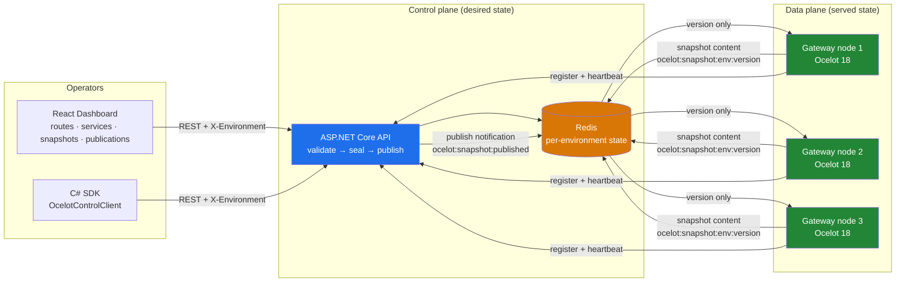
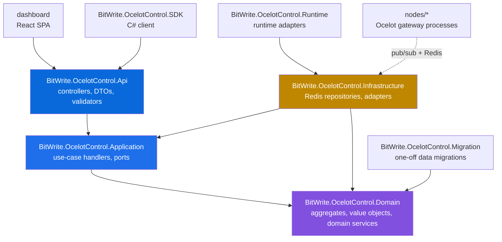
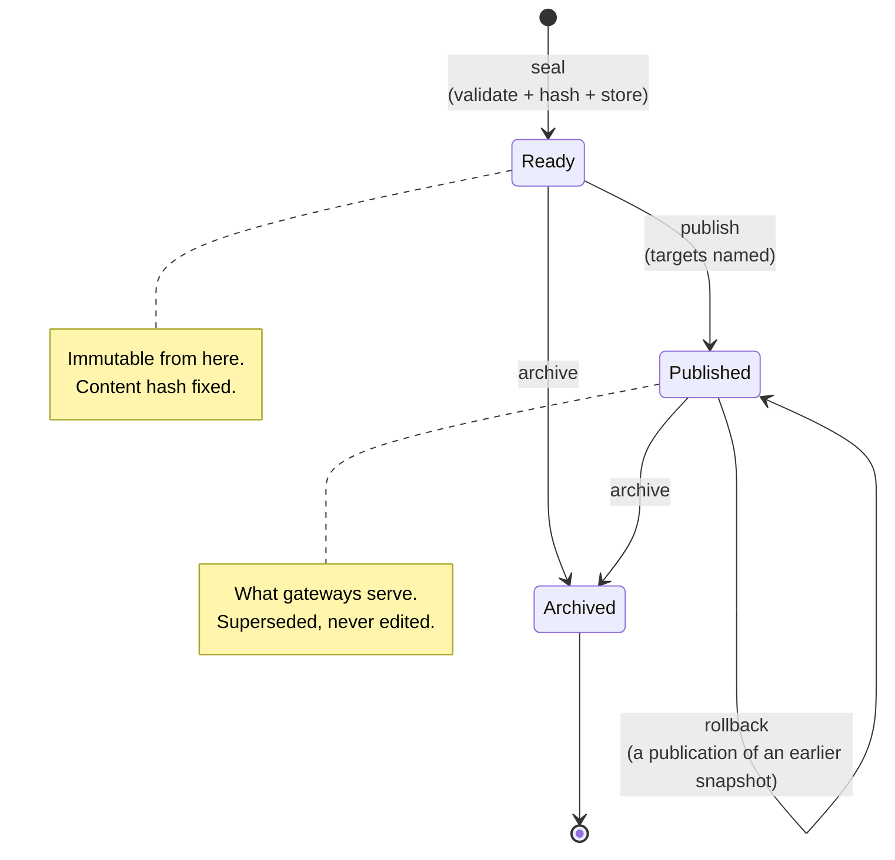

# BitWrite Ocelot Control Plane

[](https://github.com/bitwrite-dev/BitWrite-OcelotControl-Plane/actions/workflows/ci-cd.yml)
[](https://dotnet.microsoft.com/)
[](https://react.dev/)
[](#testing)
[](LICENSE)

**A gateway configuration platform that treats your `ocelot.json` as a controlled, auditable, versioned artifact — not a file someone edits on a server.**

Ocelot is an excellent .NET API gateway. But in production it is usually driven by a
single JSON file, edited by hand, deployed by hand, rolled back from memory. There is
no record of what was running last Tuesday, no validation before a typo takes down
every route, and no way to say *"this exact configuration, and only this one, is what
production serves."*

BitWrite Ocelot Control Plane turns gateway configuration into a **lifecycle**:
define routes and services as desired state → resolve and validate them into an
artifact → seal that artifact as an immutable, hash-verified **snapshot** → publish
the snapshot to a fleet of gateway nodes, to the environments you choose, with a
per-gateway delivery record and an audit trail for every transition.

---

## Table of contents

- [The problem this solves](#the-problem-this-solves)
- [How it works](#how-it-works)
- [Architecture](#architecture)
- [The lifecycle](#the-lifecycle)
- [What you can rely on](#what-you-can-rely-on)
- [Quick start](#quick-start)
- [Usage](#usage)
  - [Operator walkthrough](#operator-walkthrough)
  - [Working with environments](#working-with-environments)
  - [Running a node fleet](#running-a-node-fleet)
  - [Using the SDK](#using-the-sdk)
- [HTTP API surface](#http-api-surface)
- [Testing](#testing)
- [Repository map](#repository-map)
- [Design decisions worth knowing](#design-decisions-worth-knowing)
- [Roadmap](#roadmap)
- [Contributing and license](#contributing-and-license)

---

## The problem this solves

| Without a control plane | With BitWrite |
| --- | --- |
| `ocelot.json` edited by hand on a host | Routes, services and settings edited through a UI or API, validated on entry |
| A typo anywhere breaks every route | Five validation layers run **before** anything is sealed |
| "What changed?" answered from memory | Immutable snapshots, diffable, with SHA-256 content hashes |
| Rollback = find the old file and hope | One-click rollback to any published version, recorded as a publication |
| Everything deployed everywhere at once | Environment-scoped configuration; a publication names its target gateways |
| Staging and production drift silently | Per-environment isolation enforced on both the API and the node |
| No idea what a gateway is actually serving | Live delivery metrics per gateway, per publication |

The core idea is one sentence: **the control plane holds desired state; the gateway
nodes serve published snapshots — and never read the desired state.**

---

## How it works



1. **Operators edit desired state** in the dashboard (routes, services, global
   configuration, plugins). Every edit is validated on entry and marked *draft* —
   the route, service or settings that have changed since the last snapshot.
2. **A snapshot seals the state.** The API resolves the whole management state into
   an Ocelot configuration document, canonicalises it, computes a SHA-256 hash, runs
   the validation rules, and stores it as an immutable, versioned artifact.
   Nothing is served yet.
3. **A publication delivers a snapshot.** The operator chooses the environment and
   the target gateways; the API records the publication and announces it on a Redis
   channel — **carrying the version, never the configuration**.
4. **Nodes follow only published snapshots.** Each node subscribes to the
   channel, loads the snapshot from Redis, writes the file Ocelot reads, and reloads
   its pipeline **without a restart**. A node never reads editable state, and never
   follows another environment's publication.

---

## Architecture

Clean Architecture with domain-driven aggregates. The dependency rule is one-way and
enforced by an architecture test:



### What each project is for

| Project | Responsibility |
| --- | --- |
| `Api` | HTTP surface: REST controllers, request/response DTOs, FluentValidation, `X-Environment` enforcement. |
| `Application` | Use cases as handlers: create/validate/publish/rollback snapshots, CRUD routes & services, gateways, publications, runtime metrics. |
| `Domain` | The model: `Route`, `Service`, `GlobalConfiguration`, `Snapshot`, `Publication`, `Gateway` aggregates; value objects (`UpstreamPath`, `HttpMethod`, `DownstreamTarget`, `EnvironmentName`, …); domain services that build and validate the Ocelot document. |
| `Infrastructure` | Redis persistence (environment-scoped keys), canonicalisation, integrity hashing, outbox, adapters. |
| `SDK` | A C# client (`OcelotControlClient`) for automating everything the dashboard does. |
| `Migration` | One-off migrations (e.g. the route-key migrator), run as a tool. |
| `Runtime` | Runtime-side adapters used by delivery reporting. |
| `nodes/*` | The data plane: Ocelot 18 processes that consume published snapshots. |
| `dashboard` | The operator UI: React 19 + TypeScript + Vite + TanStack Query + Tailwind. |

### Data model in one paragraph

Routes reference services; services hold downstream hosts; global configuration
holds the settings both share. A **snapshot** is the immutable, hashed capture of
all of it for one environment. A **publication** is the act of delivering one
snapshot to a set of gateways, with a status, a timestamp, and — when something
fails — the reason. Gateways are registered endpoints that can be addressed by a
publication. Draft flags on routes, services and settings record what has changed
since the last snapshot.

---

## The lifecycle



**Snapshot versioning is append-only.** A rollback is not an undo — it is a new
publication of an earlier snapshot, so the history always shows what was served and
when. Nothing is ever mutated in place.

---

## What you can rely on

These are enforced by construction, not by convention. Each has a test.

| Guarantee | How it is enforced |
| --- | --- |
| **A served configuration is never hand-editable state** | Nodes subscribe to `ocelot:snapshot:published` / `rolled-back`, which carry a **version**. The node then loads the immutable snapshot from Redis. Editable management keys are never read by a node. |
| **A snapshot cannot be tampered with** | The document is canonicalised before storage and a SHA-256 hash is computed over the exact string stored. Round-trip integrity is tested. |
| **Nothing unvalidated is sealed** | Every seal runs route-conflict, service-reference and Ocelot-capability checks (hard failures) plus a `HasContent` warning for an empty configuration — which exists so an operator can deliberately clear a gateway. |
| **Environments cannot leak into each other** | Every request names its environment (`X-Environment`); every Redis key is environment-scoped (`ocelot:snapshot:{env}:{version}`). A node refuses a notification naming another environment, refuses to start if the current published version belongs to another one, and the API refuses a publication whose body names an environment other than the request's. |
| **A publication names its targets** | `targetGatewayIds` is required and non-empty; the dashboard sends the gateways registered in that environment. A publication that reached nobody would report success while changing nothing. |
| **A node never goes dark over a bad publication** | Refuse-and-keep: a notification naming an unreadable snapshot, a snapshot with unreadable content, or a configuration the node cannot serve — all leave the last configuration in place and log the reason. Briefly behind is better than not routing. |
| **A restarting node does not litter the fleet** | The node registers once and remembers its gateway id in Redis under its name; a gateway deleted from the dashboard is recognised (404) and re-registered. |
| **Nothing is published by accident** | Publishing asks for confirmation that names the environment, the gateways and the composition; the create step pauses when nothing has changed since the last snapshot (with an explicit *continue anyway* for a deliberate re-seal). |
| **Every transition is recorded** | Lifecycle transitions, registrations, publications and rollbacks are audit-logged with the operator identity. |
| **You are never told "it worked" when it did not** | Publications report per-gateway delivery outcomes; the runtime page shows what each gateway is actually serving and what failed. |

---

## Quick start

### Prerequisites

- .NET 8 SDK
- Node.js 22 LTS (for the dashboard — the version CI runs)
- Redis 7 (the only infrastructure dependency; CI uses `redis:7-alpine`)

### 1. Start Redis

```bash
docker run -p 6379:6379 redis:7-alpine
```

### 2. Run the API

```bash
dotnet run --project src/BitWrite.OcelotControl.Api --launch-profile http
# → http://localhost:5039  (Swagger at /swagger)
```

Set the connection string if Redis is not on localhost:

```bash
dotnet user-secrets set "ConnectionStrings:Redis" "localhost:6379" \
  --project src/BitWrite.OcelotControl.Api
```

### 3. Run the dashboard

```bash
cd dashboard
cp .env.example .env.local      # then set VITE_DEV_API_TARGET if needed
npm install
npm run dev                     # → http://localhost:5173
```

The dashboard targets the API through a dev proxy; `.env.example` documents the
settings (`VITE_API_BASE_URL`, `VITE_API_ENVIRONMENT`, `VITE_DEV_API_TARGET`).

### 4. Run a gateway node

```bash
dotnet run --project nodes/ocelot.gateway.node-1
```

The node registers itself with the control plane, subscribes to the publication
channels, and serves whatever is published for its environment. It appears on the
**Gateways** page, which is what makes it a valid publication target.

> **First run?** Create a service, then a route pointing at it, then open
> **Snapshots → New snapshot**. The wizard shows the resolved configuration as JSON
> before you seal it, runs the validation rules, and tells you exactly what will be
> published and to whom.

---

## Usage

### Operator walkthrough

Everything below is available in the dashboard; the [SDK](#using-the-sdk) automates
the same operations.

#### 1. Define the management state

- **Routes** (`/routes`) — create or edit with the wizard: upstream path and method,
  downstream service or direct targets, authentication, rate limiting, QoS,
  caching, load balancing, header and claim transformations. Invalid input is
  rejected at the form.
- **Services** (`/services`) — downstream hosts with weights and health; referenced
  by routes.
- **Global configuration** (`/global-configuration`) — base URL, request id key,
  timeouts, rate limiting, QoS, HTTP handler options, service discovery.
- **Settings** (`/settings`) — the Ocelot version a snapshot is built for and the
  system limits.

Each edit marks the entity *draft*: it has changed since a snapshot last captured
it. The create page counts what is pending so you know whether there is anything
new to seal.

#### 2. Create a snapshot

**Snapshots → New snapshot** is three steps, each one a real server transition:

1. **Select source** — the current management state, with the resolved
   configuration displayed as JSON (GitHub-dark syntax highlighting) so you read
   what will be captured, not just counts. If nothing has changed since the last
   snapshot, the step says so and pauses — with an explicit *continue anyway*.
2. **Validate** — the API resolves and validates the artifact without storing it:
   conflicts, references, capabilities, and the content warning.
3. **Review & create** — the resolved document, its hash, the version it will
   become, optional label and change summary. Sealing stores an immutable snapshot
   and clears the draft flags on everything it captured.

#### 3. Publish

From the snapshots list, **Publish** opens a confirmation that names the
environment, the gateways the publication will reach, and the composition. On
confirmation the API records the publication and announces the version; the
publications page (`/publications`) shows history, the current publication per
environment, and delivery outcomes.

**Rollback** publishes an earlier snapshot again — the history keeps both events.

#### 4. Watch the fleet

- **Runtime** (`/runtime`) — live gateway status, what each gateway is serving,
  delivery metrics per publication (attempts, successes, failures, grouping of
  identical failures), and reconcile.
- **Monitoring** (`/monitoring`) — the operational view over the same data.
- **Audit** (`/audit`) — every lifecycle transition, who initiated it, and the
  outcome.
- **Gateways** (`/gateways`) — registered nodes, their status, and deletion
  eligibility (a gateway that has been a publication target is history and cannot
  be deleted).

### Working with environments

Every request names its environment, and the sidebar selector persists the choice
— the same environment drives the API header, the snapshot you read, and the
publication you send.

```bash
# The header every client sends
curl -H "X-Environment: staging" http://localhost:5039/api/v1/snapshots
```

Environments are isolated end to end: state, snapshots and the current published
version are all scoped by environment on both sides of the wire, so a staging
snapshot can never be served by a production node. A node is pointed at an
environment by configuration:

```bash
GATEWAY_ENVIRONMENT=staging dotnet run --project nodes/ocelot.gateway.node-1
```

### Running a node fleet

A node is a small Ocelot 18 process; `nodes/README.md` documents the layout in
full. Three nodes are one layout and one code path:

```bash
# node-1 registers as itself with no settings at all
dotnet run --project nodes/ocelot.gateway.node-1

# node-2 and node-3, once instantiated from node-1 (see their README checklists)
dotnet run --project nodes/ocelot.gateway.node-2 --ASPNETCORE_URLS=http://localhost:8082
dotnet run --project nodes/ocelot.gateway.node-3 --ASPNETCORE_URLS=http://localhost:8083
```

| Setting | Variable | Default | Meaning |
| --- | --- | --- | --- |
| `Gateway:Environment` | `GATEWAY_ENVIRONMENT` | `Production` | Which environment's configuration this node serves. Names both the Ocelot file and the Redis keys. |
| `Gateway:NodeName` | `GATEWAY_NODENAME` | the assembly name | The name it registers as. Must be unique per environment. |
| `Gateway:ControlPlaneUrl` | — | `http://localhost:5039` | Where the control plane is. Without it the node still takes publications but cannot be published to. |
| `Gateway:HeartbeatSeconds` | — | `30` | How often it reports that it is alive. |

What a node guarantees, in short: it serves the last configuration it could read;
it never follows another environment's publication; it never serves editable state;
and a registration problem never stops it routing.

### Using the SDK

```csharp
var client = new OcelotControlClient(new OcelotControlClientOptions
{
    BaseUrl = "http://localhost:5039",
    Environment = "production",
});

// What is pending capture?
var routes = await client.Routes.ListAsync();

// Seal and publish, end to end
var preview = await client.Snapshots.PreviewAsync();
var snapshot = await client.Snapshots.CreateAsync(new PublishSnapshotRequest(/* … */));
await client.Snapshots.PublishAsync(snapshot.Version, new SnapshotPublishRequest
{
    InitiatedBy = "ci-bot",
    Environment = "production",
    TargetGatewayIds = gatewayIds,
});
```

Every call the dashboard makes is available to automation; the publish request
carries the environment and the target gateways, for the same reasons the UI does.

---

## HTTP API surface

Base route `/api/v1`. Every request names its environment with the
`X-Environment` header.

| Area | Endpoints |
| --- | --- |
| Routes | `GET/POST /routes`, `GET/PUT/DELETE /routes/{id}`, `POST /routes/validate`, `POST /routes/{id}/validate`, `GET /routes/{id}/preview` |
| Services | `GET/POST /services`, `GET/PUT/DELETE /services/{id}`, `GET /services/{id}/routes` |
| Global configuration | `GET /global-configuration`, `PUT /global-configuration` |
| Snapshots | `GET /snapshots`, `POST /snapshots`, `POST /snapshots/preview`, `POST /snapshots/validate`, `GET /snapshots/{version}`, `GET /snapshots/{version}/compare`, `POST /snapshots/{version}/clone`, `GET /snapshots/{version}/export`, `POST /snapshots/{version}/publish`, `POST /snapshots/{version}/rollback`, `GET /snapshots/{version}/deployment` |
| Publications | `GET /publications`, `GET /publications/current`, `GET /publications/history` |
| Gateways | `GET/POST /gateways`, `PUT /gateways/{id}`, `PATCH /gateways/{id}/status`, `DELETE /gateways/{id}`, `GET /gateways/{id}/deletion-eligibility` |
| Runtime | `GET /runtime/delivery-metrics`, `GET /runtime/status`, `GET /runtime/gateways`, `GET /runtime/gateways/{id}`, `POST /runtime/reconcile` |
| Settings | system settings, the Ocelot version catalog |
| Plugins | plugin catalogue and configuration |
| Licenses | product licensing (activation, renewal) |
| Audit | the audit log |

Swagger is enabled on the API in development (`/swagger`).

---

## Testing

The suite is 857 .NET tests and 494 dashboard tests, and it is structured so that
each layer's guarantees are tested where they live.

| Layer | What is pinned |
| --- | --- |
| Domain | aggregate invariants, lifecycle transitions, draft-state lifecycle, value-object normalisation, reconstitution round-trips |
| Application | use-case handlers with faked ports: seal, clear-on-snapshot, publish gate, rollback, metrics |
| Infrastructure | repository round-trips against a mocked Redis, environment isolation, migrations |
| API | response and request **contracts** against the dashboard's expectations (field names, required fields, the publish body), plus the fresh-install walkthrough over the real HTTP surface |
| Gateway node | the node hosting the real Ocelot pipeline: routing, reload without restart, refuse-and-keep, registration behaviour |
| Architecture | the dependency rule between layers |
| Dashboard | every page's behaviour with a mocked API: the wizard's steps, the publish confirmation, the JSON views, the environment selector's effect on requests |

```bash
dotnet test                                   # all .NET tests
cd dashboard && npm test                      # dashboard tests
cd dashboard && npm run check                 # lint + test + build
dotnet format --verify-no-changes             # formatting gate
```

---

## Repository map

```
BitWrite.OcelotControl/
├── src/
│   ├── BitWrite.OcelotControl.Api          # REST control plane
│   ├── BitWrite.OcelotControl.Application  # use cases
│   ├── BitWrite.OcelotControl.Domain       # aggregates, value objects
│   ├── BitWrite.OcelotControl.Infrastructure # Redis persistence
│   ├── BitWrite.OcelotControl.Migration     # one-off data migrations
│   ├── BitWrite.OcelotControl.Runtime       # runtime adapters
│   └── BitWrite.OcelotControl.SDK           # C# client
├── nodes/
│   ├── README.md                            # the fleet layout
│   ├── ocelot.gateway.node-1/               # the working node
│   ├── ocelot.gateway.node-2/               # placeholder + checklist
│   └── ocelot.gateway.node-3/               # placeholder + checklist
├── dashboard/                               # React operator UI
├── tests/                                   # 8 test projects
├── .github/workflows/                       # CI: lint, test, build, security scan
└── LICENSE                                  # Apache 2.0
```

---

## Design decisions worth knowing

- **The notification carries a version, not the configuration.** Pub/Sub is a
  doorbell, not a source of truth; the node reads the immutable snapshot. A node
  that served whatever a message contained would serve whatever a message
  contained.
- **Snapshots are immutable and hash-verified.** A version is a fact about the
  past, not a pointer that can be changed later.
- **Validation runs before the seal, not after.** The preview endpoint exists so
  an operator can resolve and check an artifact without storing it.
- **Draft flags are per entity, not per environment.** A snapshot captures the
  whole state, so one seal clears every flag; an edit re-flags exactly what moved.
- **Registration is remembered in Redis, keyed by node name.** The register
  endpoint mints a gateway per call; re-registering on restart would fill the
  dashboard with dead gateways.
- **Refuse-and-keep everywhere.** The subscriber, the publisher and the node all
  prefer the last good state over an empty one, and all say why in the logs.
- **`HasContent` is a warning, not a failure.** Sealing an empty configuration is
  how an operator deliberately clears a gateway, so the platform allows it and says
  what it means.

---

## Roadmap

- Node-side contract versioning: snapshots carry `contractVersion` and
  `minGatewayVersion` so an older node refuses a configuration it cannot serve —
  with its refusal visible in the publication outcome rather than as a silent
  outage. (Tracked as an issue.)
- Affected-routes and affected-gateways views on compare.
- More delivery telemetry on the runtime page.

---

## Contributing and license

Contributions are welcome. The gates that must stay green are the ones CI runs:
lint, tests on both stacks, build, and `dotnet format --verify-no-changes`.

This project is licensed under the [Apache License 2.0](LICENSE).
